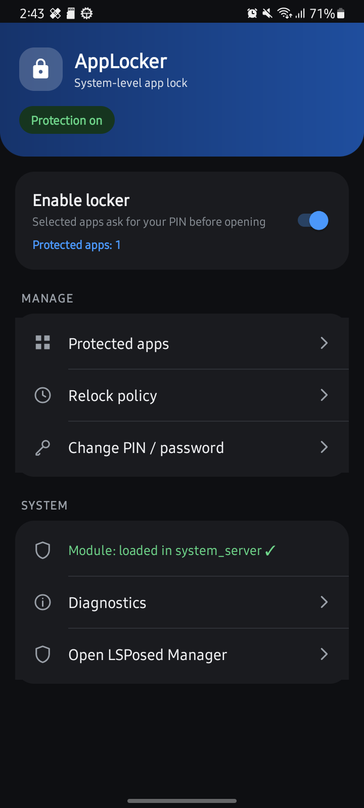
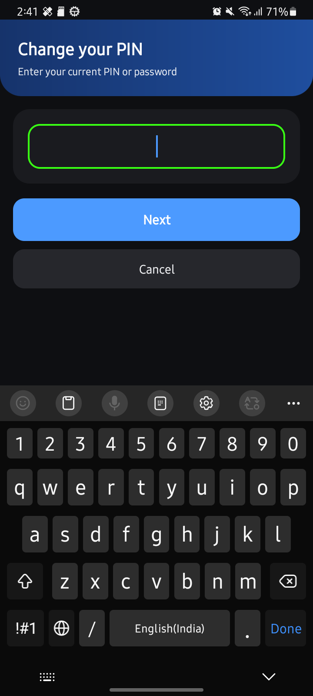

# AppLocker

System-level per-app lock for Android, built as an **LSPosed module**. Instead of
drawing overlays or using an accessibility service, AppLocker hooks the Android
system server and blocks protected apps from opening until your PIN or password is
verified.

No ads, no analytics, no internet permission.

| Home (dark) | Change PIN / password |
| --- | --- |
|  |  |

## Features

- **PIN or password** — 4–8 digit PIN or 4–32 character alphanumeric password.
  Only a PBKDF2 hash, wrapped with an Android Keystore key, is ever stored.
- **Per-app protection** — pick any launchable app from a searchable list.
- **Relock policies** — lock immediately on leaving, on screen off, after a
  configurable timeout, or keep a session unlocked until the screen turns off.
- **Safe disable switch** — turn the whole locker off without losing your setup.
- **Hardened auth screen** — full screen, `FLAG_SECURE` (no screenshots or recents
  preview), excluded from recents, and Back always goes Home instead of falling
  through to the protected app.
- **One UI style UI** — compact Samsung-keyboard-style keypad, light and dark
  themes that follow the system setting.
- **Diagnostics** — see whether the system-server module is actually loaded, plus
  a permission audit.

## Requirements

- Android 12 or newer (developed and tested on Android 13 / One UI 5.1, Galaxy A03).
- A rooted device running **LSPosed** (or another Xposed framework that can hook
  `system_server`).
- AppLocker itself needs no root access; the module host provides the hook.

## Install

1. Download the latest APK from
   [Releases](https://github.com/gautamkr0104/AppLocker/releases/latest).
2. Install it on the phone and open **AppLocker**.
3. Create your PIN or password when prompted.
4. Open **LSPosed Manager → Modules → AppLocker**:
   - enable the module,
   - set its scope to **System Framework** (`android`).
5. Reboot the phone.
6. Open AppLocker → **Protected apps** and switch on the apps you want to lock.
7. Make sure the master switch shows **Protection on**.

If the home screen says *"Module: not loaded"*, the module is not active in
`system_server` yet — re-check the LSPosed scope and reboot.

## Usage

- **Protected apps** — search and toggle apps. Apps on the safety denylist
  (launcher, system UI, AppLocker itself, …) cannot be locked.
- **Relock policy** — choose when a protected app asks for the PIN again.
- **Change PIN / password** — enter the current credential, then the new one twice.
- **Diagnostics** — hook status, configuration and a permission audit.

## Build from source

Requirements: JDK 17, Android SDK with `compileSdk 33` and build-tools installed.

```bash
# Point Gradle at your SDK
echo "sdk.dir=/path/to/Android/sdk" > local.properties

# Debug build (self-signed, installable right away)
gradle assembleDebug
```

The APK is written to `app/build/outputs/apk/debug/app-debug.apk`.

The project does not commit a Gradle wrapper. Use Android Studio (it will offer to
generate one) or a local Gradle 8.7 installation. The release build only picks up a
signing config when `../release.keystore` exists; the signing key is intentionally
**not** part of this repository.

## How it works

- `xposed/Hooks.java` runs inside `system_server` and intercepts activity starts.
- For a protected package it starts the unexported `AuthActivity` and waits.
- On a successful credential check, `AuthActivity` sends an ordered broadcast; a
  receiver in `system_server` stores a short-lived grant **before** the original
  activity is allowed to resume.
- Configuration lives in the manager app and is read through a
  `signature`-protected `ContentProvider`, so only the system-side hook (same
  signing key) can read it.
- Grants are dropped whenever the credential changes (`authVersion` bump).

## Security and privacy

- Declared permissions: one `signature`-level permission for internal IPC.
- **No** internet, accessibility, notification-listener, usage-access or
  foreground-service permissions.
- Package visibility is limited to launcher activities via a `<queries>` element.
- The auth screen is `FLAG_SECURE` and never logs or persists plaintext
  credentials.
- AppLocker relies on a rooted device and an Xposed framework. That is a
  significant trust decision — root and system hooks weaken Android's integrity
  model. Use it on your own device, at your own risk.

## Troubleshooting

| Problem | Fix |
| --- | --- |
| "Module: not loaded" | Enable AppLocker in LSPosed, scope **System Framework**, reboot. |
| Protected app opens without asking | Check the master switch and that the app is toggled on; verify Diagnostics shows the module loaded. |
| Forgot PIN/password | There is no recovery by design. Clear AppLocker's app data (this removes the credential and all protection settings). |
| Back closes the auth screen | Expected: Back always returns Home so the protected app cannot be reached. |
